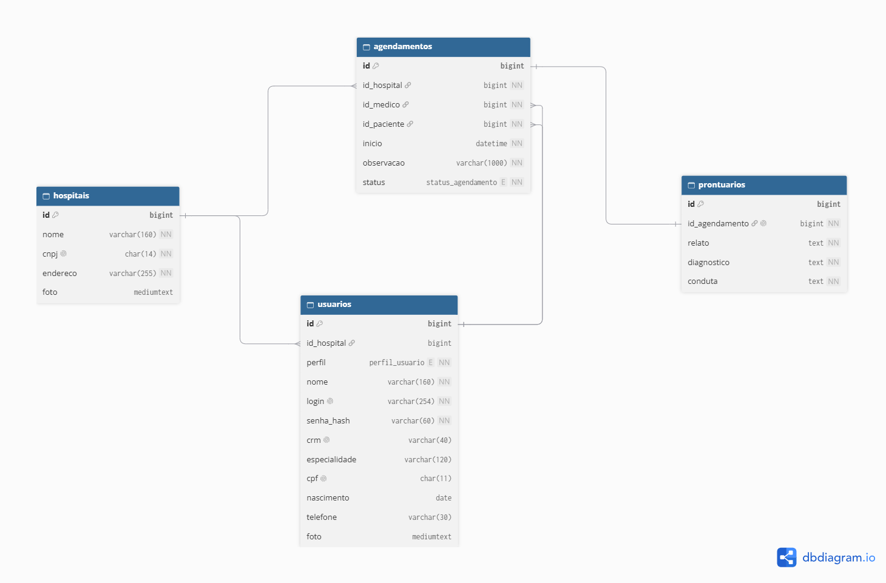

# Documentação do Projeto HealthHub

## 1. Identificação do Projeto

| Informação | Descrição |
|---|---|
| Nome | HealthHub |
| Tipo | Sistema web de gestão hospitalar, com foco em cadastros e atendimento ambulatorial |
| Instituição | Universidade do Estado do Pará — UEPA |
| Professora | Vanessa Rezende |
| Turno | Noturno |
| Repositório | https://github.com/Ggeizi/HealthHub.git |
| Versão | 1.0.0-SNAPSHOT |

O HealthHub é um projeto acadêmico desenvolvido para organizar cadastros, agendamentos e prontuários. Esta documentação apresenta as funções do sistema, a organização do código, as regras de negócio e os passos para executar a aplicação.

## 2. Integrantes e Funções

| Integrante | Responsabilidades |
|---|---|
| Geiziane | Criação da estrutura visual e interativa; atuação em UX, design, HTML, CSS e JavaScript. |
| Matheus | Organização geral, integração, refatoração e construção do backend. |
| Kevyn | Desenvolvimento do JavaScript e integração da interface com o backend. |
| José Paulo | Modelagem e hospedagem do banco no Aiven; atuação na proteção dos dados e na modelagem de classes, objetos e entidades. |

## 3. Objetivos do Projeto

### 3.1 Objetivo Geral

Desenvolver uma aplicação web que centralize cadastros de hospitais, recepcionistas, médicos e pacientes, organize os agendamentos e permita registrar e consultar prontuários, com acesso definido de acordo com o perfil de cada usuário.

### 3.2 Objetivos Específicos

- Autenticar usuários e controlar o acesso conforme seu perfil.
- Permitir ao administrador cadastrar hospitais e recepcionistas.
- Permitir à recepção cadastrar médicos e pacientes vinculados ao seu hospital.
- Organizar consultas e evitar agendamentos com o mesmo horário inicial para o mesmo médico ou paciente.
- Disponibilizar ao médico sua agenda e o registro do atendimento.
- Permitir ao paciente consultar seus agendamentos e prontuários.
- Gerar documentos PDF a partir das informações do prontuário.
- Integrar frontend, backend e banco de dados relacional.
- Aplicar conceitos de desenvolvimento web, orientação a objetos, separação de responsabilidades,integridade de dados e modelo de desenvolvimento de software.

## 4. Escopo e Funcionalidades

O HealthHub atende às etapas de cadastro, agendamento e registro de consultas ambulatoriais. Internação, gestão de leitos, estoque de medicamentos e faturamento estão fora do escopo desta versão por motivos de pouco tempo ábil para anexar esses incrementos.

### 4.1 Perfis de Usuário

| Perfil        | Funcionalidades implementadas                                                                                                       |
| ------------- | ----------------------------------------------------------------------------------------------------------------------------------- |
| Administrador | Cadastrar e listar hospitais; cadastrar recepcionistas vinculados a um hospital.                                                    |
| Recepção      | Cadastrar e listar médicos e pacientes do hospital; consultar a agenda; agendar e cancelar consultas conforme as regras do sistema. |
| Médico        | Consultar seus agendamentos; abrir, registrar e atualizar o prontuário dos atendimentos sob sua responsabilidade.                   |
| Paciente      | Consultar seus agendamentos e prontuários; baixar seus prontuários em PDF.                                                          |

Não há cadastro público de usuários. O administrador inicial é criado na primeira execução do backend, a partir das credenciais configuradas. Os demais usuários são cadastrados pelos perfis autorizados.

### 4.2 Fluxo de Atendimento

1. O administrador cadastra o hospital e um recepcionista vinculado a ele.
2. A recepção entra no sistema e cadastra os médicos e pacientes do hospital.
3. A recepção agenda a consulta, informando médico, paciente, data, horário e observação opcional.
4. O médico consulta sua agenda e abre o prontuário do atendimento.
5. O médico registra relato clínico, diagnóstico e conduta.
6. Ao salvar o prontuário, o sistema marca o agendamento como concluído.
7. O paciente acessa seu painel, consulta o prontuário e solicita o PDF.

### 4.3 Situações do Agendamento

| Situação | Significado |
|---|---|
| AGENDADO | Consulta registrada e ainda não concluída nem cancelada. |
| CANCELADO | Consulta cancelada pela recepção. |
| CONCLUIDO | Atendimento cujo prontuário foi salvo pelo médico. |

## 5. Modelo de Processo de Desenvolvimento

### 5.1 Ferramentas de Gestão e Versionamento

A nossa equipe utilizou o Taiga para organizar tarefas, distribuir atividades e acompanhar o andamento do projeto. O Git registrou as alterações no código, e o GitHub reuniu no  repositório compartilhado. 

### 5.2 Processo Adotado

O projeto seguiu um processo majoritariamente de **desenvolvimento incremental**: as funcionalidades foram construídas por partes e integradas ao sistema ao longo do trabalho.

Em cada ciclo, a equipe buscou:


2. Dividir o trabalho por páginas ou funcionalidades.
3. Elicitar requisitos funcionais e não funcionais. 
2. Modelar os dados e criar as tabelas necessárias.
3. Construir a estrutura HTML.
4. Aplicar a estilização CSS.
5. Implementar a interatividade com JavaScript.
6. Implementar as operações do backend e integrá-las à interface por meio do JavaScript.

Essa divisão permitiu trabalhar em cada funcionalidade separadamente e fazer ajustes na interface, nas regras e no banco durante a integração.

## 6. Requisitos

### 6.1 Requisitos Funcionais

| Código | Requisito |
|---|---|
| RF01 | Autenticar usuários por login e senha e permitir encerrar a sessão. |
| RF02 | Disponibilizar funcionalidades conforme os perfis ADMIN, RECEPCAO, MEDICO e PACIENTE. |
| RF03 | Permitir ao administrador cadastrar e listar hospitais. |
| RF04 | Permitir ao administrador cadastrar recepcionistas vinculados a hospitais existentes. |
| RF05 | Permitir à recepção cadastrar e listar médicos e pacientes do seu hospital. |
| RF06 | Permitir à recepção agendar consultas com médico e paciente do mesmo hospital. |
| RF07 | Consultar agendamentos conforme o perfil e o vínculo do usuário. |
| RF08 | Permitir cancelar consultas que ainda não estejam concluídas. |
| RF09 | Permitir ao médico consultar e salvar o prontuário de seus atendimentos. |
| RF10 | Marcar o agendamento como concluído ao salvar o prontuário. |
| RF11 | Permitir ao paciente consultar somente seus próprios prontuários. |
| RF12 | Permitir ao paciente baixar seu prontuário em PDF. |
| RF13 | Criar o administrador inicial mediante configuração, sem duplicar um login existente. |

### 6.2 Requisitos Não Funcionais

| Código | Requisito | Aplicação no projeto |
|---|---|---|
| RNF01 | Persistência em banco relacional | Scripts SQL para MySQL, com chaves primárias e estrangeiras. |
| RNF02 | Controle de acesso | Spring Security protege páginas e endpoints conforme o perfil. |
| RNF03 | Proteção de senhas | Uso de hash BCrypt; senhas não são persistidas em texto puro pelas rotinas de cadastro. |
| RNF04 | Proteção CSRF | Token disponibilizado em /api/csrf e utilizado nas operações de alteração. |
| RNF05 | Manutenibilidade | Separação entre controllers, services, repositories, models e utilitários. |
| RNF06 | Consistência nas operações | Uso de transações em operações de agendamento e atendimento. |
| RNF07 | Validação de entradas | Validações de tamanho, obrigatoriedade, formato e vínculos de usuários. |
| RNF08 | Adaptação visual | Uso de media queries para ajustar o layout a diferentes larguras de tela. A compatibilidade em todos os dispositivos ainda precisa ser verificada. |
| RNF09 | Execução em navegador | Uso de HTML, CSS, JavaScript, Fetch API e HTMX. A compatibilidade com diferentes navegadores ainda precisa ser verificada. |


### 6.3 Regras de Negócio

- O administrador não possui hospital associado; os demais perfis devem estar vinculados a um hospital.
- Médico e paciente de um agendamento devem pertencer ao hospital da recepção autenticada.
- Não pode haver outro agendamento não cancelado com o mesmo início para o mesmo médico ou paciente no hospital.
- A verificação de conflito compara horários iniciais iguais; não calcula sobreposição por duração de consulta.
- Consultas concluídas não podem ser canceladas pelo sistema.
- Atendimentos cancelados não podem receber prontuário pelo médico.
- Há um prontuário por agendamento; novas gravações atualizam seu conteúdo.
- Relato, diagnóstico e conduta são obrigatórios e aceitam até 10.000 caracteres cada no backend.
- Senhas devem ter pelo menos oito caracteres e no máximo 72 bytes em UTF-8.
- CPF e CNPJ são verificados pelo formato numérico e quantidade de dígitos; não há validação dos dígitos verificadores nessa rotina.
- O cadastro de paciente rejeita nascimento futuro ou anterior ao ano 1000.

## 7. Tecnologias, Ferramentas e Versões

As tabelas abaixo apresentam as tecnologias utilizadas e as versões declaradas na configuração do projeto.

### 7.1 Frontend

| Tecnologia | Finalidade                                                          | Versão ou identificação           |
| ---------- | ------------------------------------------------------------------- | --------------------------------- |
| HTML       | Estrutura das páginas e formulários                                 | HTML5                             |
| CSS        | Estilização, componentes e adaptação de layout                      | Sem versão                        |
| JavaScript | Interatividade, eventos, validações de interface e requisições HTTP | JavaScript nativo                 |
| HTMX       | Carregamento de fragmentos HTML e composição das telas              | 2.0.11, referenciada via jsDelivr |
| Fetch API  | Comunicação assíncrona com o backend                                | API nativa do navegador           |

Não há dependência de React ou de Node.js para executar o frontend desta versão, haja vista que usamos as tecnologias frontend sem framework tradicional.


#### 7.1.1 HTMX

- Link da documentação oficial : https://htmx.org/reference/?utm_source=chatgpt.com


| Atributo / Função | Finalidade | Exemplo |
|---|---|---|
| `hx-get` | Busca conteúdo HTML por uma requisição GET. | `hx-get="formulario-recepcao.html"` |
| `hx-target` | Define o elemento HTML que receberá a resposta. | `hx-target="#formulario"` |
| `hx-swap` | Define como o conteúdo será inserido no elemento. | `hx-swap="innerHTML"` |
| `innerHTML` | Substitui o conteúdo interno do elemento, mantendo sua tag. | `hx-swap="innerHTML"` |
| `outerHTML` | Substitui o elemento inteiro, incluindo sua tag. | `hx-swap="outerHTML"` |
|  |  |  |

### 7.2 Backend

| Tecnologia    | Finalidade                                              | Versão                             |
| ------------- | ------------------------------------------------------- | ---------------------------------- |
| Java          | Linguagem de programação utilizada para escrever a lógica backend                                    | 17 |
| Spring Boot   | Framework que facilita a criação de APIs , gerenciamento de dependências  e configuração da aplicação java | 3.5.7                              |
| Apache Maven  | Ferramenta que gerencia dependências, compila o código executa testes e empacota o projeto                    | 3.9.11 na distribuição do Wrapper  |
| Maven Wrapper | Executa o Maven utilizando a versão configurada pelo projeto            | 3.3.4                              |

### 7.3 Bibliotecas e Dependências Diretas

| Dependência                  | Finalidade                                                  | Versão/configuração                            |
| ---------------------------- | ----------------------------------------------------------- | ---------------------------------------------- |
| spring-boot-starter-web      | APIs HTTP, Spring MVC, JSON e servidor web embarcado        | 3.5.7, herdada do gerenciamento do Spring Boot |
| spring-boot-starter-jdbc     | Acesso ao banco com JDBC e JdbcClient                       | 3.5.7, herdada do gerenciamento do Spring Boot |
| spring-boot-starter-security | Autenticação, autorização e proteção de requisições         | 3.5.7, herdada do gerenciamento do Spring Boot |
| mysql-connector-j            | Driver JDBC para MySQL                                      | Gerenciada pelo Spring Boot;                   |
| OpenPDF                      | Leitura do modelo, preenchimento de campos e geração do PDF | 2.0.5                                          |
| spring-boot-maven-plugin     | Integração do ciclo Maven com Spring Boot                   | Gerenciada pelo parent 3.5.7                   |

Para consultar as versões de todas as dependências, incluindo as gerenciadas pelo Spring Boot, execute `.\mvnw.cmd dependency:tree` no PowerShell, dentro da pasta `Backend`.

### 7.4 Banco de Dados e Ferramentas

| Ferramenta       | Finalidade                                           | Versão             |
| ---------------- | ---------------------------------------------------- | ------------------ |
| MySQL            | Sistema gerenciador do banco relacional              | 8.4.13             |
| Aiven            | Hospedagem do banco de dados                         | Serviço gerenciado |
| Beekeeper Studio | Cliente gráfico para consultar e administrar o banco | 6.3.0              |
| Taiga            | Organização das tarefas                              |                    |
| Figma                 | Para a criação das interfaces                                                       |                    |
| Vscode                      | IDE  utilizada para realizar o projeto                                                                                    |                    |

## 8. Arquitetura da Aplicação

O HealthHub utiliza uma arquitetura web em camadas, com backend monolítico. O navegador exibe as páginas, executa JavaScript e envia requisições para a API. Os controllers recebem essas requisições, os services aplicam as regras e os repositories executam consultas SQL no MySQL.

O acesso ao banco é feito com JDBC e `JdbcClient`, por meio de consultas SQL. As classes da pasta `model` representam os dados da aplicação. 

O Maven também copia os arquivos do frontend para os recursos estáticos do backend. Assim, páginas e API podem ser servidas pelo próprio Spring Boot, na mesma origem.

A ideia principal da nossa equipe foi desenvolver um projeto organizado, modularizado e componentizado, facilitando futuras alterações, manutenções e a reutilização de código, além de evitar arquivos muito extensos e com responsabilidades misturadas.

Para isso, utilizamos os arquivos `main.css`, `main.js` e `index.html` como pontos centrais de organização e integração dos diferentes componentes do frontend. Dessa forma, conseguimos separar melhor as responsabilidades de cada arquivo, reutilizando estilos, funções, classes e atributos em diferentes partes do sistema.

O uso do **HTMX** também foi importante nessa organização, principalmente por permitir o carregamento dinâmico de componentes HTML sem a necessidade de recarregar a página inteira. Com atributos como `hx-get`, `hx-target` e `hx-swap`, conseguimos carregar formulários e outras partes da interface conforme a interação do usuário.

Essa abordagem ajudou a reduzir a repetição de código HTML e a necessidade de escrever JavaScript apenas para realizar atualizações simples na interface.

Com isso, buscamos construir um frontend mais limpo, organizado e de fácil manutenção, no qual cada componente possui uma responsabilidade específica e pode ser alterado sem exigir grandes modificações nas demais partes do projeto.

### 8.1 Organização das Pastas

```text
HealthHub/
├── Frontend/
│   ├── HTML/
│   │   ├── Login/
│   │   ├── Cadastro/
│   │   ├── Admin/
│   │   ├── Recepcao/
│   │   ├── Medico/
│   │   └── Paciente/
│   ├── CSS/
│   └── JAVASCRIPT/
├── Backend/
│   ├── .mvn/wrapper/
│   ├── mvnw.cmd
│   ├── pom.xml
│   └── src/main/
│       ├── java/com/healthhub/
│       │   ├── config/
│       │   ├── controller/
│       │   ├── error/
│       │   ├── model/
│       │   ├── repository/
│       │   ├── security/
│       │   ├── service/
│       │   ├── util/
│       │   └── HealthHub.java
│       └── resources/
│           ├── application.properties
│           └── pdf/modelo-prontuario.pdf
└── Database/
    └── Migrations/
```

### 8.2 Responsabilidades das Camadas

| Pasta | Responsabilidade | Exemplos |
|---|---|---|
| config | Configurações e inicialização | CorsConfig, AdminInicial |
| controller | Recebimento de requisições e respostas HTTP | Acesso, Hospitais, Recepcao, Atendimentos |
| service | Regras de negócio e coordenação de operações | HospitalService, RecepcaoService, AgendamentoService, AtendimentoService |
| repository | Consultas e alterações no banco | UsuarioRepository, HospitalRepository, AgendamentoRepository, ProntuarioRepository, Agenda |
| model | Representação dos dados | Usuario, Medico, Paciente, NovoAgendamento, Prontuario, TextoProntuario |
| security | Autenticação e permissões | Seguranca, UsuarioLogin |
| util | Funções compartilhadas | Validacao, Imagem, ProntuarioPdf |
| error | Tratamento de erros | Erros |

## 9. Modelo de Dados

| Tabela | Dados principais | Relacionamentos |
|---|---|---|
| hospitais | Nome, CNPJ, endereço e foto | Referenciada por usuários e agendamentos. |
| usuarios | Perfil, nome, login, hash da senha e informações específicas de médico ou paciente | id_hospital referencia hospitais. |
| agendamentos | Hospital, médico, paciente, início, observação e situação | Referencia hospitais e usuarios para médico e paciente. |
| prontuarios | Relato, diagnóstico e conduta | id_agendamento referencia agendamentos e é único. |

As tabelas usam chaves primárias numéricas com incremento automático. CNPJ, login, CRM e CPF possuem restrições de unicidade conforme os scripts. As chaves estrangeiras preservam os vínculos entre os registros, e o mecanismo declarado é InnoDB.

O banco utiliza uma única tabela de usuários para os quatro perfis. Campos como CRM e especialidade se aplicam ao médico; CPF, nascimento e telefone são utilizados no cadastro do paciente.

## 10. Principais Endpoints

| Método | Rota | Finalidade / acesso |
|---|---|---|
| GET | /api/csrf | Obter token de proteção CSRF. |
| POST | /api/login | Autenticar por formulário com login e password. |
| POST | /api/logout | Encerrar sessão. |
| GET | /api/me | Consultar usuário autenticado. |
| GET / POST | /api/admin/hospitais | Listar / cadastrar hospitais — administrador. |
| POST | /api/admin/hospitais/recepcao | Cadastrar recepcionista — administrador. |
| GET / POST | /api/recepcao/medicos | Listar / cadastrar médicos — recepção. |
| GET / POST | /api/recepcao/pacientes | Listar / cadastrar pacientes — recepção. |
| GET / POST | /api/recepcao/agendamentos | Listar / criar agendamentos — recepção. |
| PATCH | /api/recepcao/agendamentos/{id}/cancelar | Cancelar consulta — recepção. |
| GET | /api/medico/agendamentos | Consultar agenda do médico. |
| GET / PUT | /api/medico/agendamentos/{id}/prontuario | Abrir / salvar prontuário — médico responsável. |
| GET | /api/paciente/agendamentos | Consultar agenda do paciente. |
| GET | /api/paciente/prontuarios | Listar prontuários do paciente. |
| GET | /api/paciente/prontuarios/{id}/pdf | Baixar PDF do próprio prontuário. |

A autenticação utiliza sessão e cookie JSESSIONID, não JWT. As operações protegidas exigem o perfil adequado e, nas alterações, token CSRF válido.

## 11. Modelagem do Sistema

O diagrama abaixo apresenta o diagrama/modelo utilizado pela nossa equipe para a modelagem do sistema:




## 12. Configuração e Execução

### 12.1 Pré-requisitos

- JDK compatível com o alvo Java 17 do projeto.
- Acesso a um servidor MySQL com o esquema preparado.
- Conexão à internet para baixar dependências e carregar o HTMX.
- Navegador com suporte às APIs web utilizadas.

### 12.2 Preparação do Banco

Execute os scripts de `Database/Migrations` nesta ordem:

1. `cria_banco_dados.sql` — cria e seleciona o banco healthhub.
2. `criar_tabela_usuarios.sql` — cria hospitais e usuarios.
3. `criar_tabela_agendamentos.sql` — cria agendamentos.
4. `criar_tabela_prontuario.sql` — cria prontuarios.

Em uma instância gerenciada que utilize um banco já existente, ajuste a criação/seleção do esquema às permissões disponíveis e mantenha a URL JDBC apontando para esse mesmo esquema. Os scripts da pasta `Migrations` devem ser executados manualmente.

### 12.3 Variáveis de Configuração

O backend importa opcionalmente um arquivo `.env` no diretório de execução, interpretado como propriedades. Dentro de Backend, configure:

```properties
DB_URL=jdbc:mysql://SEU_HOST:SUA_PORTA/SEU_BANCO
DB_USERNAME=SEU_USUARIO
DB_PASSWORD=SUA_SENHA
ADMIN_LOGIN=administrador@exemplo.com
ADMIN_PASSWORD=SENHA_INICIAL_COM_PELO_MENOS_8_CARACTERES
```

Os valores acima são exemplos, não credenciais reais. Para Aiven, utilize os parâmetros de conexão e TLS exigidos pela instância. A variável `DB_USERNAME` precisa estar definida no arquivo ou no ambiente, pois é utilizada em `application.properties`.

Se ADMIN_LOGIN e ADMIN_PASSWORD estiverem ambos vazios, a criação inicial do administrador é ignorada. Alterar a senha configurada não redefine automaticamente a senha de um administrador já existente: a inserção ignora a duplicidade de login.

### 12.4 Execução no Windows

No PowerShell, a partir da raiz do projeto:

```powershell
cd Backend
.\mvnw.cmd spring-boot:run
```

Depois da inicialização, acesse `http://localhost:8080/`, caso a porta padrão não tenha sido substituída no ambiente. A aplicação redireciona para a página de login.

Para gerar o pacote:

```powershell
.\mvnw.cmd clean package
```

### 12.5 Conferência Após a Inicialização

Para conferir o fluxo principal da aplicação:

1. Entre com as credenciais do administrador configuradas no ambiente.
2. Cadastre um hospital e um recepcionista vinculado a ele.
3. Acesse o perfil da recepção e cadastre um médico e um paciente.
4. Agende uma consulta para esses usuários.
5. Entre com o perfil do médico e registre o prontuário da consulta.
6. Acesse o perfil do paciente e confira o agendamento, o prontuário e o download do PDF.


## 14. Limitações e Melhorias Futuras

Finalizamos nosso projeto com alguns pontos a melhorar e corrigir para futuras versões:

- Verificar conflitos considerando a duração das consultas, além do horário inicial.
- Validar os dígitos verificadores de CPF e CNPJ.
- Adaptar a geração de PDF para prontuários que ocupem mais de uma página.
- Ampliar os testes em diferentes navegadores e tamanhos de tela.
- Criar testes automatizados para as regras de agendamento, permissões de acesso e registro de prontuários.
- Avaliar o desempenho com vários usuários acessando o sistema ao mesmo tempo.
- Tornar a aplicação mais responsiva a tela menores como as de celulares e tablets.
